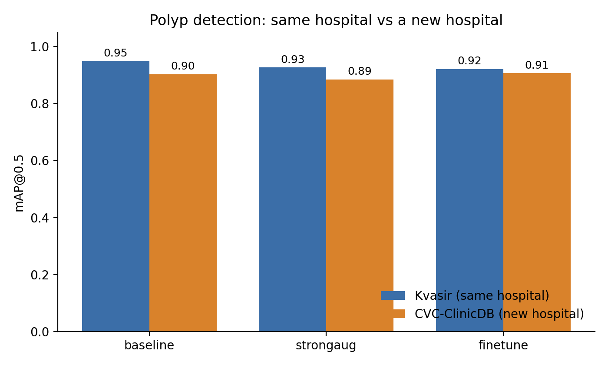
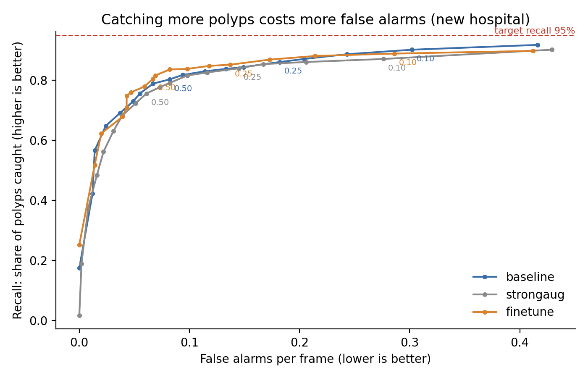

# Polyp Detection in Colonoscopy: Does It Survive a New Hospital?

Real-time detection of colorectal polyps (growths that can become cancer) with YOLO,
trained on images from one hospital and tested on a hospital it has never seen.

**The question this project asks:** A model can score well on its own test set and
still fail at a new hospital, where the camera, lighting and patients are different.
How big is that drop for polyp detection, and what does it take to fix it?

---

## How to reproduce

### Step 0: What you need
- A Google account (for Google Colab, which gives you a free GPU)
- This folder, zipped as `polyp-detection.zip`
- About a weekend of compute time, spread over a few sessions

You don't need a GPU of your own. Everything runs in Colab.

### Step 1: Open Colab with a GPU
1. Go to https://colab.research.google.com and choose **File → Upload notebook** → `polyp_detection_colab.ipynb`
2. **Runtime → Change runtime type → T4 GPU → Save**
3. Run the first cell. It should print `Tesla T4`.

### Step 2: Upload the project
Run the "Upload the project" cell and pick `polyp-detection.zip`. It unzips and installs the libraries.

### Step 3: Get the datasets
The notebook downloads both datasets for you:

| Dataset | What it is | Where it comes from |
|---|---|---|
| **Kvasir-SEG** | 1,000 polyp images with masks, checked by a gastroenterologist | Vestre Viken hospitals, Norway: https://datasets.simula.no/kvasir-seg/ |
| **CVC-ClinicDB** | 612 frames from 29 colonoscopy videos, with masks | Hospital Clinic, Barcelona: https://polyp.grand-challenge.org/CVCClinicDB/ |

**If a download fails:**
- **Kvasir:** open https://datasets.simula.no/kvasir-seg/ in your browser, download `kvasir-seg.zip`, upload it into the `raw/` folder in Colab, and rerun the cell.
- **CVC-ClinicDB:** download it from Kaggle (search "cvcclinicdb", the `balraj98` upload), unzip it into `raw/cvc/`, then point `--cvc` at the folder that contains `Original` and `Ground Truth`.

Both datasets are for research and education only, and you **must cite them** (citations below).

### Step 4: Convert the masks to boxes
```
python prepare_data.py --kvasir raw/Kvasir-SEG --cvc raw/cvc/CVC-ClinicDB
```
Both datasets label polyps as masks (exactly which pixels are polyp). YOLO needs boxes,
so the script draws the tightest box around each separate polyp, and skips tiny specks
of mask noise.

How the data is split:
- **Kvasir:** 80% train / 10% val / 10% test (random)
- **CVC:** first 20% of frames for fine-tuning, the remaining 80% held out as the "new hospital" test.
  The split is by frame order, not random. CVC frames come from videos, so neighbouring frames
  are near-duplicates. A random split would leak test frames into training and inflate the
  score. Data leakage like this is a common way medical AI results get overstated.

### Step 5: Train the three experiments
```
python train.py --exp baseline     # standard training on Kvasir only
python train.py --exp strongaug    # Kvasir only, heavy colour/lighting/rotation augmentation
python train.py --exp finetune     # baseline + a small slice of CVC mixed in
```
Each one takes roughly 20–40 min on a free T4. **Colab disconnects after a while**, so
run the Drive backup cell after each experiment.

### Step 6: Evaluate
```
python evaluate.py
```
This tests every model on **Kvasir test** (same hospital) and **CVC test** (new hospital), and saves to `results/`:
- `results.csv`: precision, recall (= sensitivity), mAP50, mAP50-95
- `domain_shift.png`: the headline chart
- `cvc_examples_*.jpg`: green = doctor's box, red = model's box

### Step 7: Real-time demo
```
python demo.py --weights runs/finetune/weights/best.pt --source data/yolo/cvc/images/test
```
This makes `results/demo.mp4` with boxes and an FPS counter. Colonoscopy video runs at about
25–30 FPS, so if the model is faster than that, it can run live during the procedure.

### Step 8: Put it on GitHub
Push the code, this README, and the `results/` folder (charts, example grids, CSVs, demo video).
Keep the datasets and `runs/` out of the repo, since the dataset licences don't allow
redistributing them.

---

## Results

All models are YOLO11s trained on a free Colab T4 GPU (baseline and strong augmentation: 50 epochs;
fine-tuning: 30 epochs). Each takes 8–13 minutes to train, and inference is about 5.5 ms per frame,
which is well above real-time colonoscopy video rates.



| Model | Kvasir mAP50 | CVC mAP50 | Kvasir mAP50-95 | CVC mAP50-95 | CVC precision | CVC recall |
|---|---|---|---|---|---|---|
| Baseline | 0.949 | 0.903 | 0.771 | 0.611 | 0.860 | **0.852** |
| Strong augmentation | 0.927 | 0.885 | 0.709 | 0.441 | 0.856 | 0.827 |
| Fine-tuned (+122 CVC frames) | 0.922 | 0.907 | 0.756 | 0.635 | **0.908** | 0.810 |

Kvasir = same hospital (100 test images). CVC-ClinicDB = new hospital, never seen in training (490 test frames, 512 polyps).

### What I found

**1. At the new hospital, the model still finds most polyps, but its boxes get much worse.**
mAP50 dropped by about 0.05, while mAP50-95, which rewards tight boxes, dropped by 0.16. Recall fell
from 0.91 to 0.85.

**2. Augmentation alone did not help.** Heavy colour, lighting and rotation augmentation lowered
every metric, and box accuracy at the new hospital collapsed to 0.44. These augmentation settings were
probably too aggressive for 50 epochs.

**3. Fine-tuning made the model cleaner but less safe.** With 122 new-hospital frames, precision went
up (0.86 → 0.91), but recall went down (0.85 → 0.81). For cancer screening that is the wrong trade-off.
A false alarm costs the doctor a second look. A missed polyp can become cancer.

### Choosing a threshold for screening

Because a missed polyp matters more than a false alarm, I tested every confidence threshold on the
new-hospital set (`threshold_sweep.py`):



| Baseline threshold | Recall | Polyps missed (of 512) | False alarms per frame |
|---|---|---|---|
| 0.25 (default) | 0.861 | 71 | 0.18 |
| **0.10 (chosen)** | **0.902** | **50** | **0.30** |
| 0.05 | 0.918 | 42 | 0.42 |

- Going from 0.25 to 0.10 catches **21 more polyps**, at the cost of about one extra false alarm every 8 frames.
- Going from 0.10 to 0.05 catches only 8 more, and adds 40% more false alarms. That's where the trade
  stops being worth it.
- **No model reached 95% recall at any threshold.** About 8% of polyps were never matched by any box.
  A lower threshold can't fix that. It needs a better model, or more varied training data.
- Per frame, 0.30 false alarms still means several false boxes per second at video speed. A real system
  would need smoothing across frames, for example only showing a box once it appears in several frames in a row.

### Where it fails (see `results/cvc_examples_*.jpg`)
- **Stool and debris:** bright yellow residue is flagged as a polyp.
- **Fluid and glare:** a large box over a pool of liquid, with the real polyp only partly covered.
- **Oversized boxes** at the new hospital, which explains the mAP50-95 drop.
- Clear, rounded, well-lit polyps are found with high confidence (0.8–0.9).

### Takeaway
A detector that scores 0.95 at its own hospital still misses polyps elsewhere. A lower threshold buys
back some of them, and the simple fixes (augmentation, a little fine-tuning) didn't help the number that
matters most clinically. A good benchmark score isn't the same as being safe for patients.

## Next steps
- **Per-polyp detection:** CVC frames come from 29 video sequences. A polyp counts as caught if any of its frames is detected, which is closer to what matters in a real procedure.
- **How much new-hospital data is needed:** fine-tune with 5–100% of the CVC slice and plot the curve.
- **Pick models by recall** instead of overall mAP when fine-tuning.
- Swap to segmentation (`yolo11s-seg.pt`) since you already have masks
- Test on a third dataset (ETIS-Larib or CVC-ColonDB) to see if the pattern holds

## Limitations (be upfront about these)
- Still images, not full procedure videos
- Small datasets: about 1,600 images across two centres
- Not clinically validated, so this is a research prototype only

## Citations
- Jha D. et al. *Kvasir-SEG: A Segmented Polyp Dataset.* MultiMedia Modeling (MMM), 2020.
- Bernal J. et al. *WM-DOVA maps for accurate polyp highlighting in colonoscopy: Validation vs. saliency maps from physicians.* Computerized Medical Imaging and Graphics 43, 99–111, 2015.
- Ultralytics YOLO: https://github.com/ultralytics/ultralytics

## Files
| File | What it does |
|---|---|
| `polyp_detection_colab.ipynb` | Runs the whole pipeline in Colab, top to bottom |
| `prepare_data.py` | Masks → YOLO boxes, leakage-safe splits, dataset configs |
| `train.py` | The three experiments |
| `evaluate.py` | Same-hospital vs new-hospital metrics, chart, example images |
| `threshold_sweep.py` | Recall vs false alarms at every confidence threshold |
| `demo.py` | Annotated video with FPS counter |
